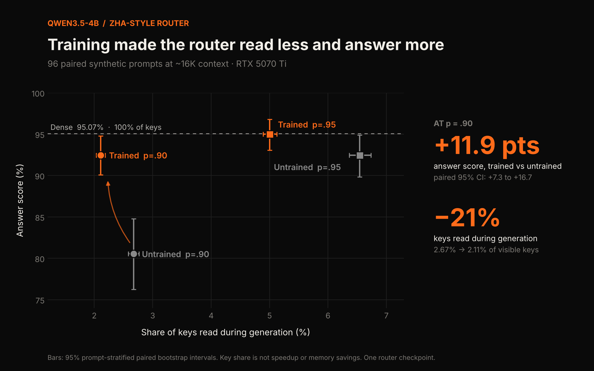
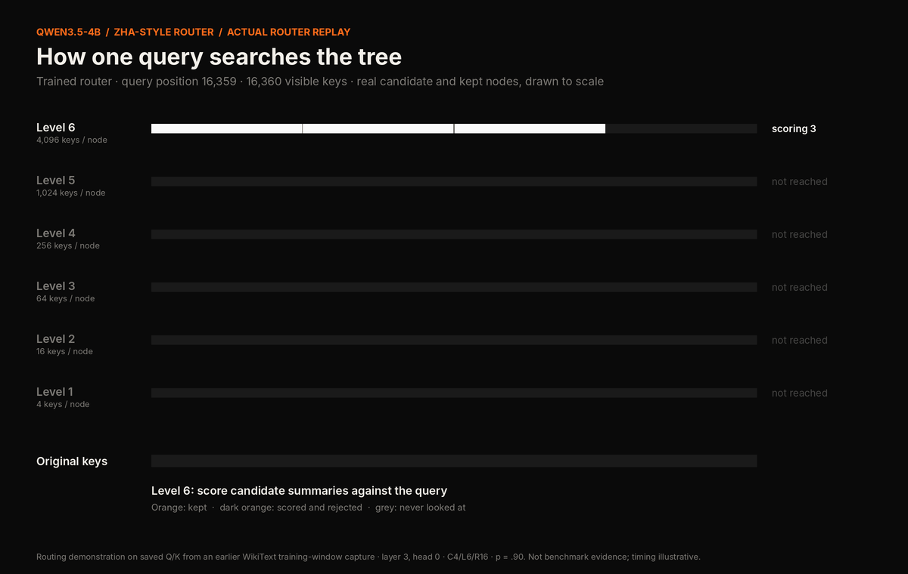

# ZHA on Qwen3.5-4B

An adaptation of [Zyphra Hierarchical Attention (ZHA)](https://arxiv.org/html/2610.42112v2) to **Qwen3.5-4B-Base** on a single **RTX 5070 Ti (16 GB)**. It also includes a controlled test of whether training the router improves *answers*, not just how well it imitates attention.



## Result

On 96 fresh RULER prompts at ~16K tokens, at routing threshold p = 0.90:

| Configuration | Score | All items found | Prefill keys read | Decode keys read |
|---|---:|---:|---:|---:|
| Dense | 95.07% | 77/96 | 100% | 100% |
| Untrained router, p=.90 | 80.54% | 39/96 | 10.54% | 2.67% |
| **Trained router, p=.90** | **92.47%** | **69/96** | **7.95%** | **2.11%** |
| Untrained router, p=.95 | 92.45% | 66/96 | 21.85% | 6.54% |
| Trained router, p=.95 | 95.00% | 75/96 | 16.99% | 5.00% |

- Training improved the p=.90 score by **+11.93 points** (paired 95% bootstrap CI **+7.31 to +16.68**, whole prompts resampled within task) while selecting **fewer** keys in both prefill and decode.
- The gain is uneven: variable tracking supplies about 72% of it. Common-word extraction stays below dense (87.92% vs 94.17%).
- Trained p=.95 is close to dense (95.00% vs 95.07%), but the paired difference interval (about −2.2 to +2.1 points) does **not** establish equivalence.
- A post-hoc word-boundary scoring check (the frozen scorer counted "rail" inside "railway") leaves the training benefit at +11.93 points. See `evidence/SCORING_SENSITIVITY.md`.

**This is slow.** Mean prefill + decode time was ~142–146 s per sparse run vs 5.8 s for dense. Tree building, routing and gathering run in plain PyTorch. These are operational timings, not a controlled speed benchmark.

## What was built

- The attention backend is replaced in Qwen3.5-4B's **8 full-attention layers**, for both prefill and decode. The 24 Gated DeltaNet layers are unchanged.
- The router uses the paper's deep geometry, **C4 L6 R16**: chunk size 4, six levels, 16 reference queries per KV head, shared across levels and the query heads in each KV group.
- The base model is frozen. Only the reference queries train: **131,072 parameters** (4 KV heads × 16 × 256 × 8 layers).
- The original KV cache is still stored. Selecting fewer keys is not memory compression.

## Training

- **Data:** 64 PG-19 books × 16,384 tokens plus 64 WikiText-2 articles × 4,096 tokens. That's 1,310,720 unique tokens over 2 epochs (≈2.62M token exposures), one document per example with no packing.
- **Loss:** per-level KL(dense attention pooled into chunks ‖ router's predicted chunk distribution), summed over levels.
- **Optimizer:** independent per-layer AdamW, betas (.9, .95), peak LR .032, WSD schedule (20 warmup updates, final 20% linear decay to 1% of peak), 256 updates per layer, seed 94121.
- **Validation KL (R16):** PG-19 2.98 → 0.93; WikiText-2 2.31 → 0.63. An R4 run is included for comparison.
- **Time:** the logged R16 training work totals ~10.4 minutes. That excludes setup, validation and checkpoint writing, so it is not total elapsed time.

Details: `training/TRAINING_RUN.txt`.

## How this differs from the paper

| | Zyphra (ZHA paper) | This repo |
|---|---|---|
| Model | Qwen3.6-35B-A3B | Qwen3.5-4B-Base |
| Router | C4 L6 R16 (and others) | C4 L6 R16 |
| Training tokens | ~0.996B | ~2.62M exposures (≈380× less) |
| Evaluation | Reasoning, coding, RULER to 256K, LongBench v2 | 4 synthetic RULER tasks at ~16K |
| Speed | Roofline performance model | Measured; unoptimized reference code |

This is a small-budget **adaptation**, not a reproduction. None of the paper's quality or speed claims are tested here.

## Verify the numbers

No GPU, model download or third-party packages needed (Python 3.10+):

```bash
cd evidence
python final_experiment_verify.py
```

It checks all 480 rows, the 96 paired prompts, source/prompt/checkpoint hashes, 279,688 routed layer calls with zero dense fallbacks, recomputes the paired intervals, and checks the scoring-sensitivity analysis. It does not rerun inference.

## Repository layout

| Path | Contents |
|---|---|
| `evidence/` | The final 480-run experiment: frozen source, prompts (`cases/`), every generated answer (`final_results.jsonl`), summaries, integrity audit, logs, router checkpoints and the verifier |
| `training/` | The trainer, loss, tree builder, data-prep and overlap-audit scripts, dataset manifests, training records, and the R16 checkpoint |
| `routing_replay/` | Saved dense Q/K for one layer, both routers, the CPU reference selector and the full routing trace behind the animations |
| `figures/` | The chart and animations, plus the scripts that render them from the files above |

## Routing animations



`figures/tree_replay.gif` and `figures/query_replay.gif` replay real router decisions from `routing_replay/`. They are **routing demonstrations, not benchmark evidence**. The queries and keys come from an earlier WikiText *training*-window capture (layer 3, head 0), not the held-out test prompts. `figures/tree_search.gif` is a schematic illustration of the algorithm.

## Limits

One trained checkpoint, one initialization, four synthetic task families and one context range (~16K). Nothing here establishes broad language quality, reasoning or coding performance, generalization to longer contexts, or any speedup. The inference and training scripts keep the original Windows paths and environment assumptions (PyTorch 2.14.1+cu130, Transformers 5.21.0, Python 3.14.2), so treat them as historical source to inspect and adapt, not a turnkey installer. Base-model weights and corpora are not included.

## Credits

- Zyphra, [*Subquadratic Attention with a Hierarchical Tree-Structured Indexer*](https://arxiv.org/html/2610.42112v2).
- The tree-of-summaries idea first clicked for me through Victor Taelin's [OptMem](https://github.com/VictorTaelin/OptMem).
- Evaluation prompts are generated with [RULER](https://github.com/NVIDIA/RULER) at a pinned commit (see `evidence/protocol.json`).
